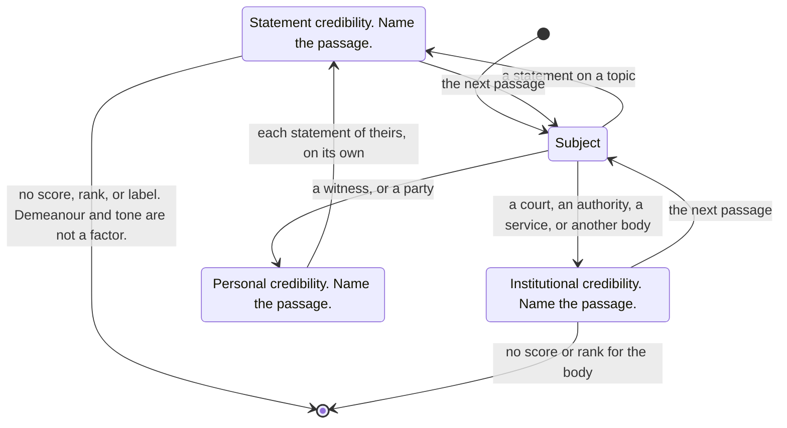

# credibility

Same questions for every party, on a statement and a topic.
No score, rank, or label for the person.
Demeanour and tone are not a factor.
Name the passage.

## Statement credibility

A contradiction is two statements in one document, a statement here and one made elsewhere, or a statement against a fact.
One of two contradictory statements is false.
Showing that is usually cheaper than finding a contradicting fact.

A history of false or misleading statements lowers a later statement.
A recorded condition that includes psychosis or lying bears on the statement.

A story that depends on a rare event needs stronger evidence.

Corroboration from other witnesses weighs more than a single source.
Significant contact beforehand, and statements that match in the details, can mean the testimony was coordinated.

## Institutional credibility

An institution is a court, an authority, a service, or another body in the record.
No score or rank for the body.
Name the passage.

What the body stated before bears on what it states now.
What the record says the body did bears on what it states now.
Interest in the outcome bears on it.

Corroboration is another source.
A second passage from the same body is not corroboration.

## Personal credibility

The person is a witness, or a party to the case.
No score, rank, or label for the person.
Demeanour and tone are not a factor.

A history of false or misleading statements lowers what they say later.
A recorded condition that includes psychosis or lying bears on what they say.
Interest in the outcome bears on it.

Each statement is still read on its own, under statement credibility.
