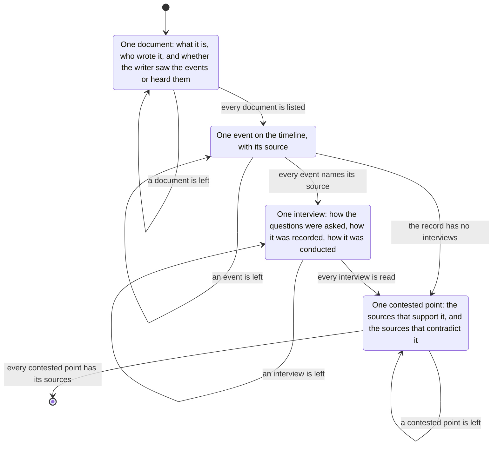

# evidence

Inventory first.
For each document: what it is, who wrote it, and whether the writer saw the events or heard them.

Then a timeline.
Each event names its source.

Then the interviews, including a child's.
How the questions were asked, how it was recorded, how it was conducted.

Then each contested point: which sources support it, and which contradict it.
