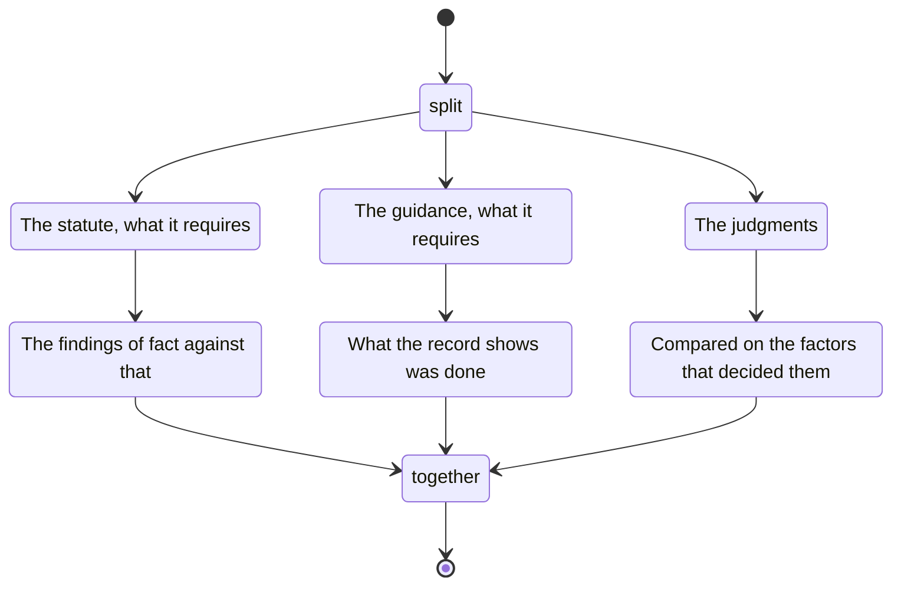

# governing

The statute: what it requires, then the findings of fact against that.

The guidance: what it requires, then what the record shows was done.

The judgments, compared on the factors that decided them.
