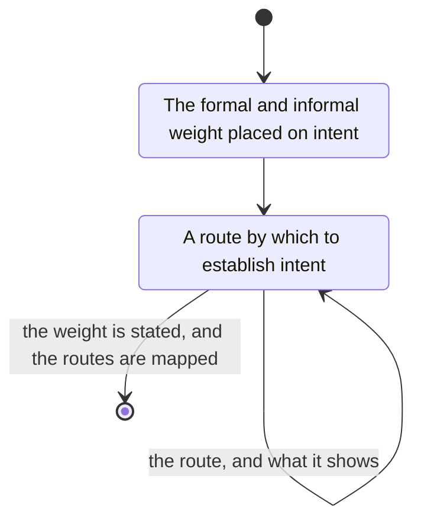

# how to analyze intent

- figure out formal and informal weight placed on intent
- map out all routes by which to establish intent, including but not limited to
  - presence of actions that align with intent
  - previously held similar intent
  - written/witnessed/recorded expressions of intent
  - surrounding facts align with intent
  - etc 
