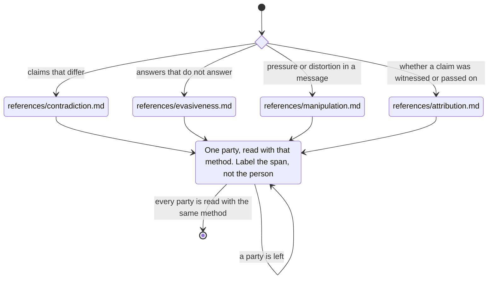

# language

Every party.
Label the span, not the person.
Load only the method in hand.

| Method | What it labels | File |
| --- | --- | --- |
| contradiction | Claims that differ within one speaker, between parties, or against the record | `references/contradiction.md` |
| evasiveness | Answers that do not answer, and hedges, against that speaker's own baseline | `references/evasiveness.md` |
| manipulation | Pressure and distortion in a message. Counts and spans, not a diagnosis | `references/manipulation.md` |
| attribution | Whether the speaker saw it, was told it, read it, or inferred it | `references/attribution.md` |
