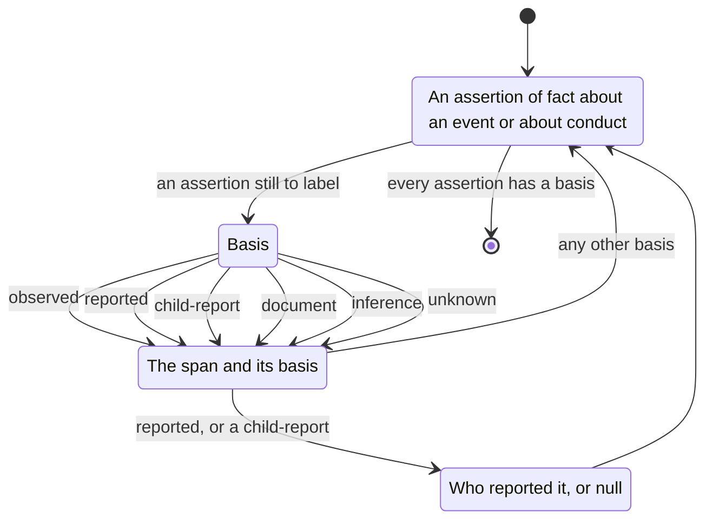

# attribution



For each assertion of fact, labels how the speaker knows it.
Other analyses use this to separate what was witnessed from what was passed on.

## `language/attribution/sources@1` (basic)

**In scope:** any account, including professional reports.

**Instruction:** For each assertion of fact about an event or a person's conduct, extract the span and label its basis.

**note:**
```json
{"speaker": "#(P1V1)|<role>", "topic": "<slug>",
 "basis": "observed|reported|child-report|document|inference|unknown",
 "reported_by": "#(P3V1)|<role>|null", "confidence": 0.0}
```
- `observed` — the speaker says they saw or heard it themselves
- `reported` — someone told them (`reported_by` names who)
- `child-report` — the child told them; keep this separate from `reported`
- `document` — they read it in a document
- `inference` — they conclude it from other facts
- `unknown` — no basis is given

Reuse the topic slugs already present in the set's passes.

## Done
- Every extracted assertion has a basis label.
- Every `reported` or `child-report` label names who reported it, or is `null` and noted in the report.
