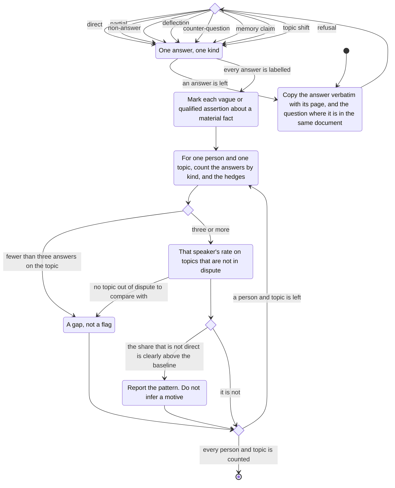

# evasiveness

An evasive answer does not answer the question.
Vagueness on a point that matters is the same kind of thing.
The comparison is with that speaker's own usual way of answering, not with a perfect answer.

Questions and answers come from interviews, hearings, and message threads where someone asks a direct question.
The answer is copied verbatim, with its page.
When the question is in the same document, the question is copied too.

An answer is one of these.

- Direct: it answers what was asked.
- Partial: it answers only part.
- Non-answer: it responds without the content that was asked for.
- Deflection: it turns to someone else's conduct.
- Counter-question: it answers with a question.
- Memory claim: "I don't recall", "kan ikke huske", and the like.
- Topic shift: it moves to another subject.
- Refusal: it declines to answer.

A separate reading marks a vague or qualified assertion about a material fact.
The kinds are a hedge, a vague time, a vague actor, a passive with no actor, and an approximation.
Phrases such as "I think", "maybe", "around then", "mistakes were made", "vist nok", "måske", "jeg tror", "på et tidspunkt", and "der blev sagt" are only a start.
The label follows what the sentence does, not the single word.

For each person and each topic, the answers are counted by kind, and so are the hedges.
The baseline is that person's rate on topics that are not in dispute.
A topic stands out only when the share of answers that are not direct is clearly above that baseline, and there are at least three answers on the topic.
Fewer than three answers is a gap, not a flag.

A memory claim can be genuine, especially for an old or routine event.
A leading question, or the other party being in the room, can produce a non-answer.
The pattern is reported.
A motive is not inferred.
