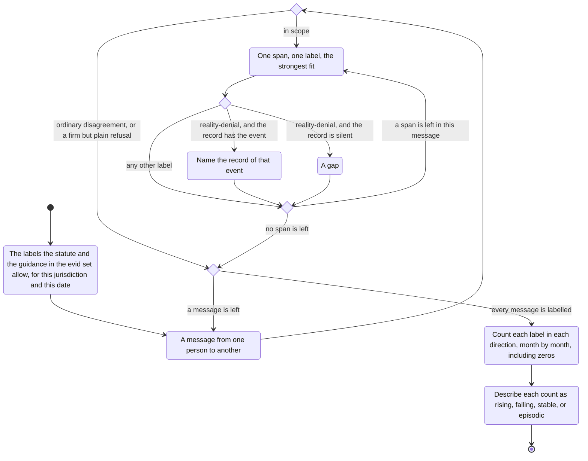

# manipulation

This labels pressure and distortion in a message.
It describes the message.
It does not diagnose the person.

Which of these labels the case can use comes from the statute and the guidance in the evid set, for this jurisdiction and the date.
Coercive control, psychological violence, or a definition the record itself uses, are read from there.

A message from one person to another is in scope.
That includes party to party, party to a child, and party to an authority.
Ordinary disagreement is not.
A firm but plain refusal is not.
One span takes one label, the strongest fit.

- A threat states a harm unless the recipient complies.
- An ultimatum sets a deadline, or a single choice, on an open matter.
- Guilt makes the recipient responsible for the sender's feelings, or the child's, in order to get compliance.
- Minimisation shrinks the sender's own reported conduct.
- Blame-shifting answers a point about the sender by moving responsibility onto someone else.
- Reality-denial denies that an event happened, or that something was said.
- Using the child as messenger puts adult conflict through the child.
- A loaded characterisation uses a charged label instead of conduct.
- A false dilemma offers two options as the only ones, when others are plainly available.

Each label is counted in each direction, month by month, including zeros.
The count is described as rising, falling, stable, or episodic.
Where a reality-denial meets a record of the event, that record is named.
Where the record is silent, that is a gap.

A clinical or syndrome name is not used for a person.
The result is a count and the spans.
Whether the pattern matters in law is left to the writing of the document.
