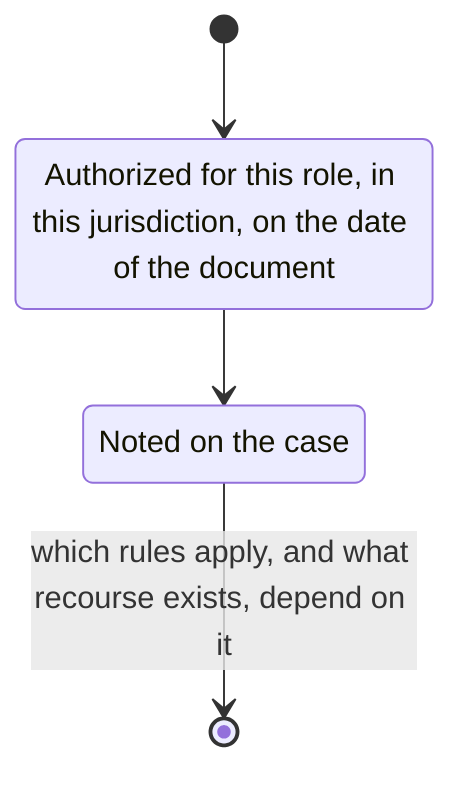

# authorization

Find whether this author was authorized for this role, in this jurisdiction, on the date of the document.

Note that on the case.
Which rules apply, and what recourse exists, depend on it.
