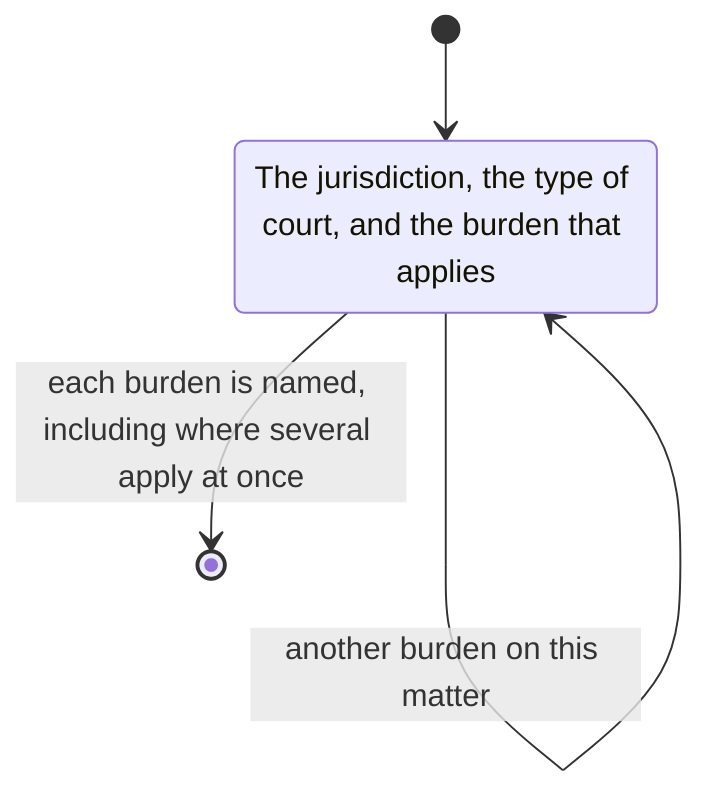

# burden-of-proof

Check the jurisdiction and type of court and the burden of proof that applies.
Carefully navigate and explain when multiple BoP are relevant in a case. 
  Example: 
    - Family law matter --> civil BoP
    - False statement to court in above case --> criminal BoP
