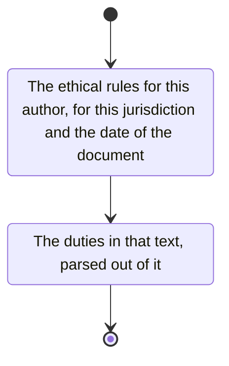

# conduct

Obtain the ethical rules for this author, for this jurisdiction and the date of the document.

- code of conduct or ethical guidelines for legal professionals
- ethical guidelines for judges

The duties are the ones in that text.
Parse them out of it.
