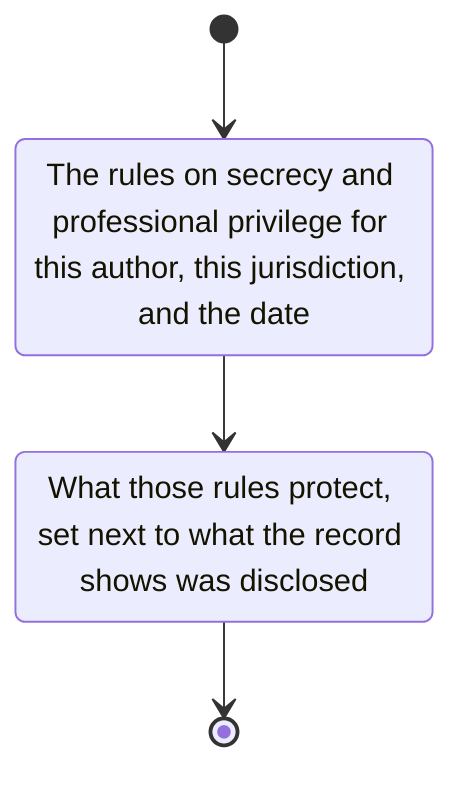

# confidentiality

Obtain the rules on secrecy and professional privilege for this author, for this jurisdiction and the date of the document.

Set what those rules protect next to what the record shows was disclosed.
