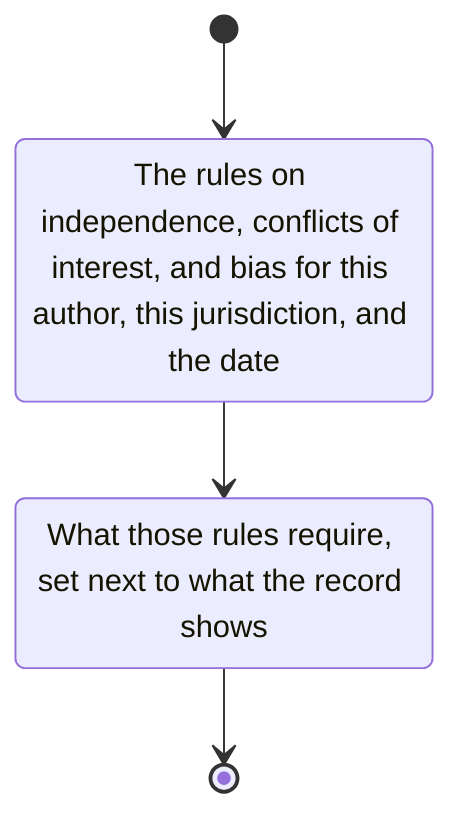

# impartiality

Obtain the rules on independence, conflicts of interest, and bias for this author, for this jurisdiction and the date of the document.

Set what those rules require next to what the record shows.
