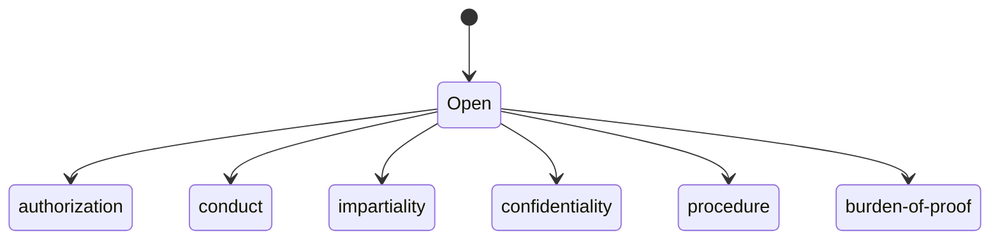

# legal-standards

Open one sub.

- `authorization` — whether this author was entitled to do the work
- `conduct` — the ethical rules for this author
- `impartiality` — independence, conflicts of interest, and bias
- `confidentiality` — secrecy and professional privilege
- `procedure` — court procedure and administration of justice
- `burden-of-proof` — which burden this matter uses
