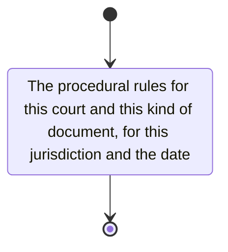

# procedure

Obtain the procedural rules for this court and this kind of document, for this jurisdiction and the date of the document.

- court procedural manuals
- law and judicial guidelines on administration of justice
