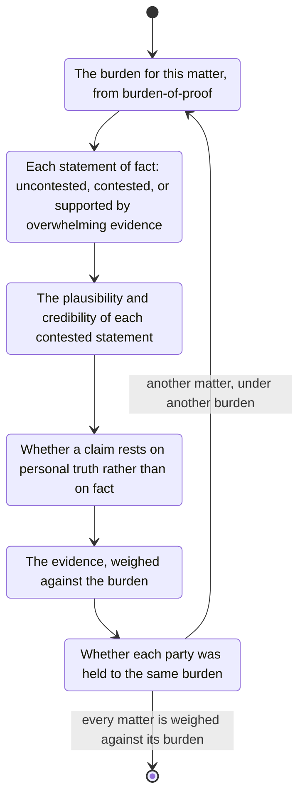

# probability

The basis of any law is weighting evidence against the relevant burden of proof.
That is a probabilistic concept.

Related concepts:

- Likelihood is a synonym for probability.
- Credibility means a statement by a credible person is more likely to be accurate or true.
- A plausible statement is more likely to be true.
  An implausible statement requires more evidence to be believed.
- Discrimination means a person receives harsher sanctions, is required to submit more evidence, or is in some other way disadvantaged procedurally, more than is warranted based on group membership.
- Fairness and a fair trial.
  Obtain the exact wording for the jurisdiction and the date.

# burden of proof

- For a civil matter, obtain the burden of proof for the jurisdiction and the date.
  One figure in use is 50 percent: more likely than not, or the balance of probabilities.
- For a criminal matter, obtain the burden of proof for the jurisdiction and the date.
  One figure in use is 9x percent: beyond reasonable doubt.
- List the other burdens this matter uses.

# truth and probability

- Actual truth is theoretically impossible to determine.
  In most real cases, facts exist.
- Uncontested statements of fact are more likely to represent the actual facts.
- Statements of fact supported by overwhelming evidence are more likely to represent the facts.

# personal truth

- Some ideologies deny the existence of facts and proclaim them to be personal.
- This is generally not a functional basis for law.
  It affects therapy, for example, which may feed information into legal matters.
- Be very observant of whether this is in play.
