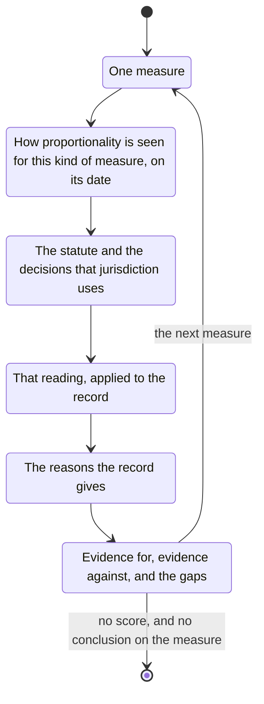

# proportionality

One measure at a time.

Find how proportionality is seen in the jurisdiction that applies, for this kind of measure, on the date of the measure.
Obtain that from the statute and the decisions that jurisdiction uses.
Apply it to the record.

The reasons the record gives.
The evidence for the measure, the evidence against it, and the gaps.

No score.
No conclusion on the measure.
