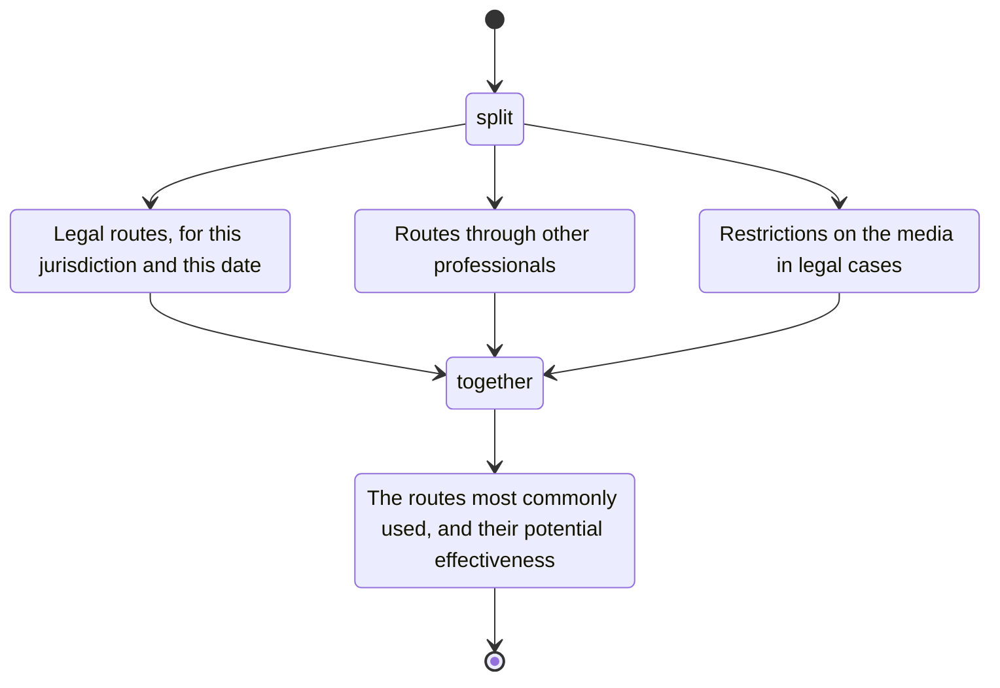

# recourse

For a matter, identify the routes of recourse for the jurisdiction and the date.

- Legal
  - Appeal a case.
  - A complaint about the case, or about the behavior of a professional in the case.
  - Start a case in another system, such as criminal, civil, or human rights.
- Other professionals
  - Appeals boards of professional bodies.
  - Ethics committees.
  - Legal action.
- Media
  - Restrictions on the media in legal cases.

When working with the user on recourse, identify the routes most commonly used, their potential effectiveness, and so on.
