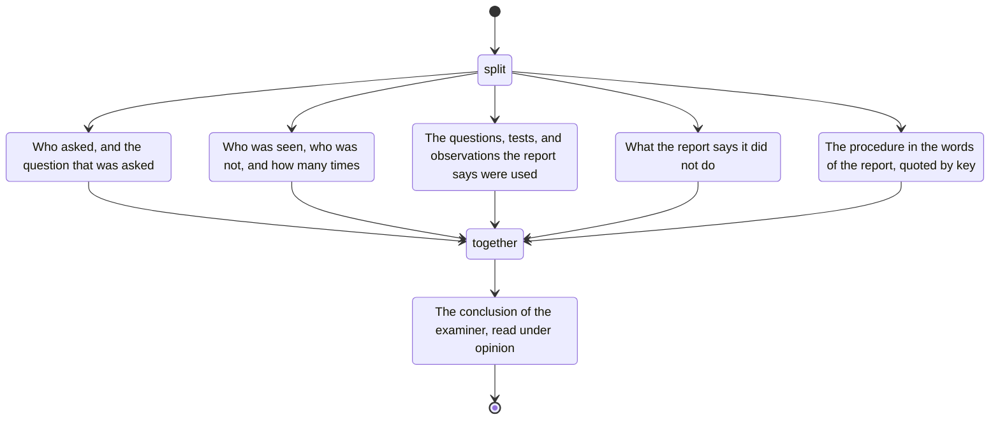

# examination

- the mandate: who asked, and the question that was asked
- who was seen, who was not, and how many times
- the questions, tests, and observations the report says were used
- what the report says it did not do
- the procedure in the report's words, quoted by key
- the examiner's conclusion is a separate statement.
  It is read under `opinion`
