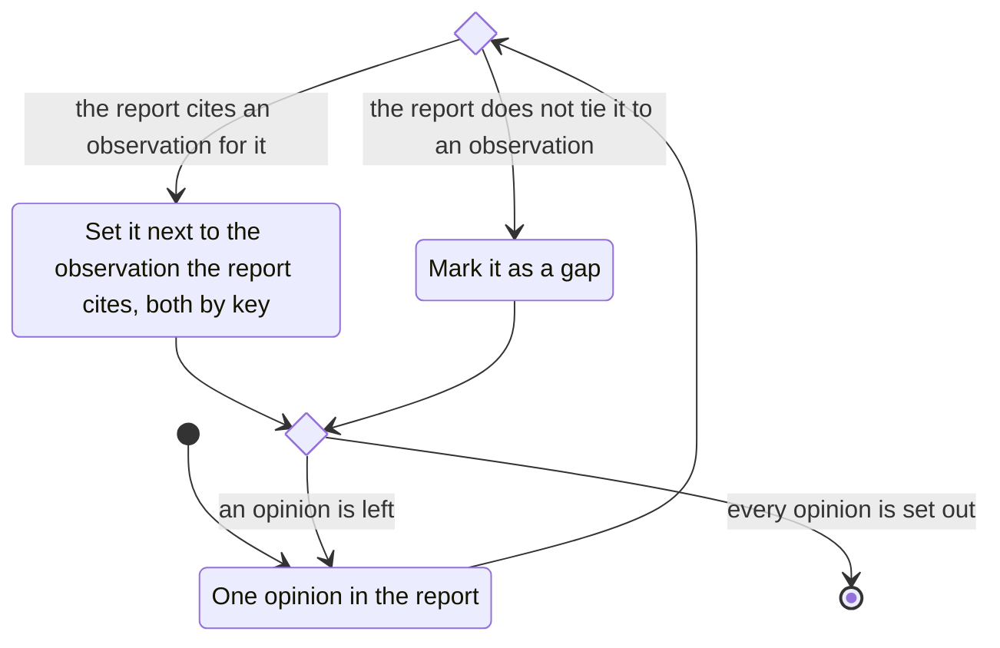

# opinion

- each opinion next to the observation the report cites for it, both by key
- an inference the report does not tie to an observation is a gap
- label the statement, not the person
- no score, rank, or diagnosis adopted as a finding
- the opinion is the examiner's statement.
  Weighing it is authoring
