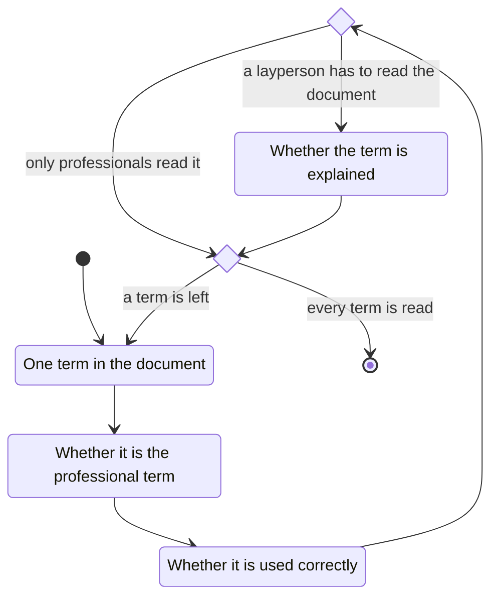

# professionalism

When reading a document written by a psychologist, look at the terminology.

Are the terms the correct professional terms?
Are they used correctly?
Where a layperson has to read the document, does the psychologist explain the term?
