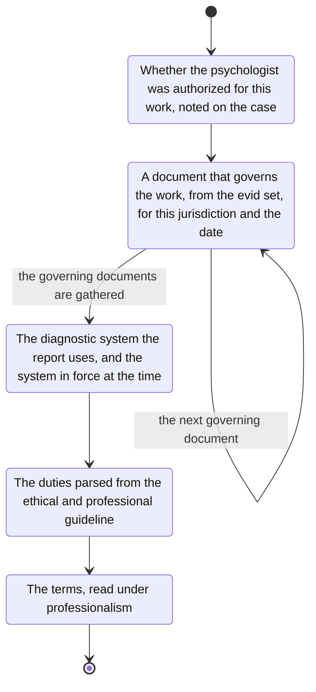

# standards

Where a psychologist is involved, find whether they were authorized for this work.
Note that on the case.
Which rules apply, and what recourse exists, depend on it.

Read the report against the documents that govern the work.
Take them from the evid set for this jurisdiction and the date of the work:

- the statute
- the professional guidelines
- the ethical guidelines
- the licensing board
- the guideline for that procedure or that kind of report, such as a custody evaluation

Note the diagnostic system the report uses.
Obtain which system was in force at the time of the matter, and whether the report used that one.

The full list of professional duties is the one in the ethical and professional guideline that governs this psychologist.
Parse it out of that guideline.
Look for at least:

- correct procedure
- correct handling of information
- being up to date in the field, and having the professional knowledge
- keeping professional distance
- disclosing conflicts of interest
- disclosing insufficient specialisation, and dealing with it by consultation
- correct use of professional terminology, and whether a lay reader is told what the term means

`professionalism` reads the terms in the document against that guideline.
