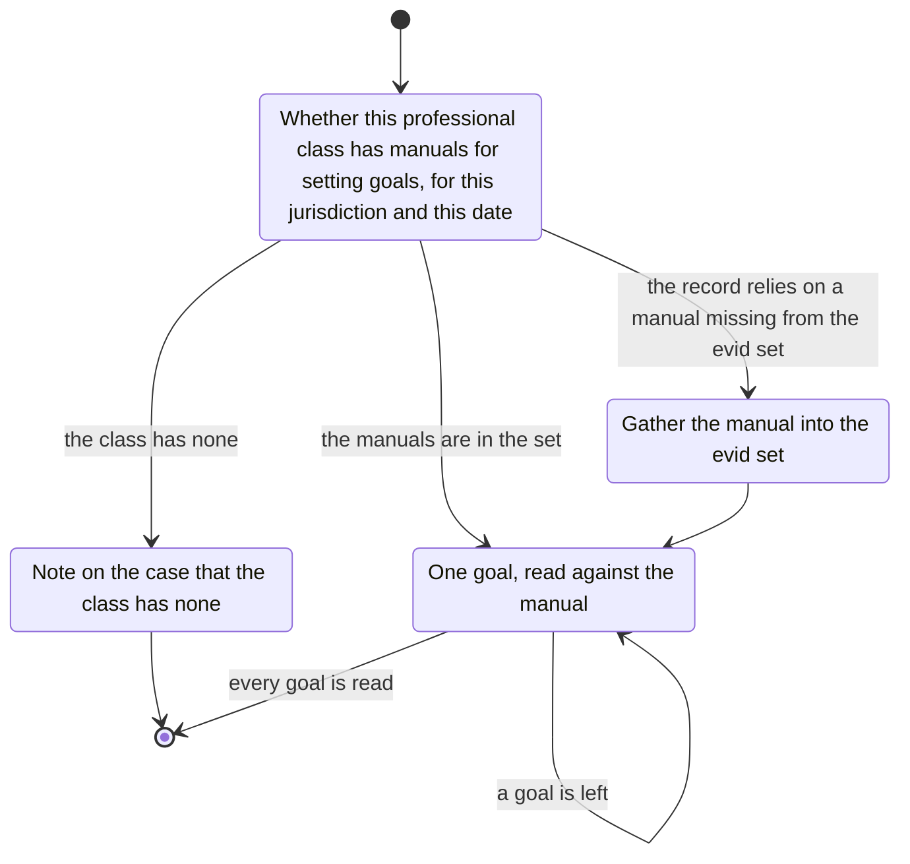

# goal-setting

Find whether this professional class has manuals for setting goals.
Where it has none, note that on the case.
SMART is one form those manuals take.
Obtain the manuals this class uses, for this jurisdiction and this date.
Gather them into the evid set when the record relies on them and they are missing.

Read each goal against that manual.
Note a goal the manual treats as vague, open-ended, trivial, or out of line with the interest of the person helped.
