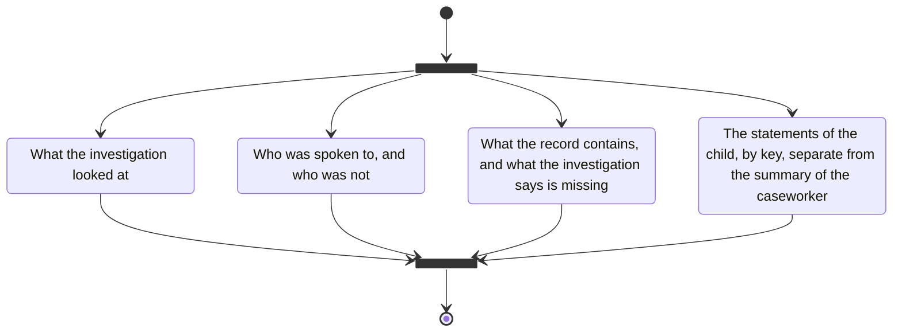

# investigation

- what the investigation looked at: the child, the home, school, health, the network
- who was spoken to, and who was not
- what the record contains, and what the investigation says is missing
- the child's statements by key, separate from the caseworker's summary
- no score for a parent or a child

