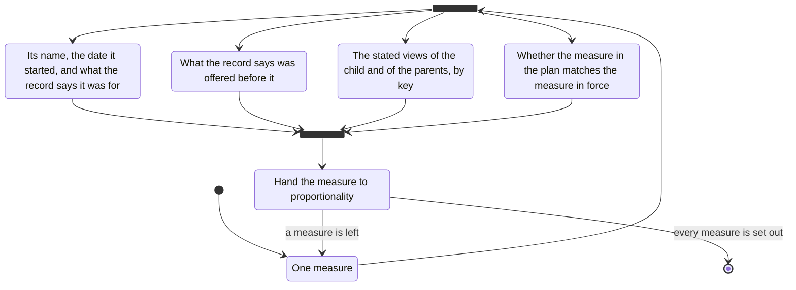

# measures

- each measure named, with the date it started and what the record says it was for
- what the record says was offered before it
- the child's and the parents' stated views, by key
- whether the measure in the plan matches the measure in force
- the legal test of a measure is `proportionality`
