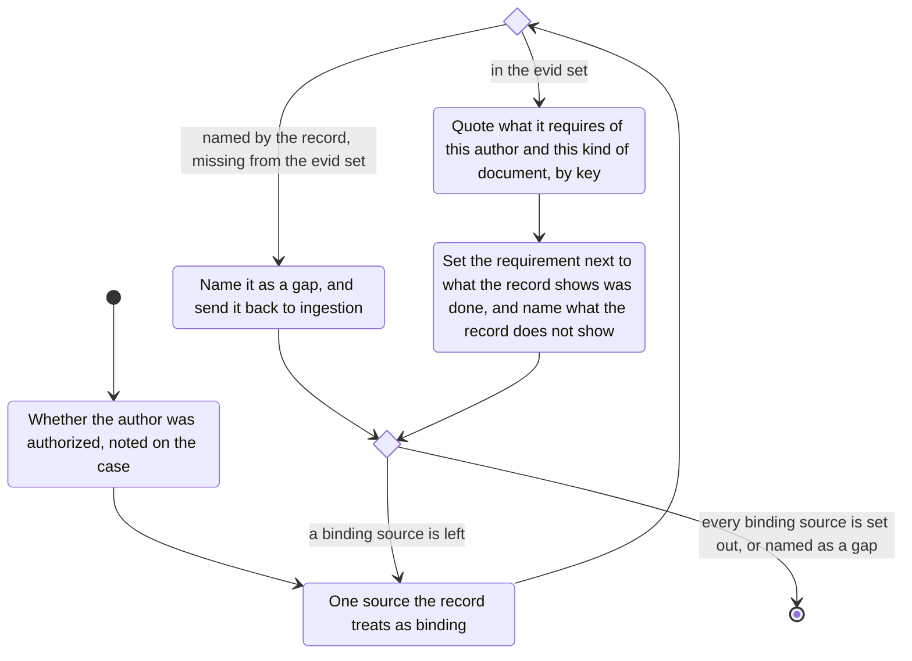

# social-standards

Note whether the author was authorized, and record that on the case.
Which rules apply, and what recourse exists, depend on it.

## What to get

Take these from the case evid set (add them if not there), and only the ones the record treats as binding:

- the statute the decision applies
- the guidance the document says it followed
- the professional and ethical rules for the profession the document names
- the standard for that kind of document, when the record names one

A source the record names that is not in the set is a gap.
Name it and go back to ingestion.

## How to extract

From each of those documents, take what it requires of this author and this kind of document.
Quote the requirement by key.
Set it next to what the record shows was done, and name what the record does not show.
